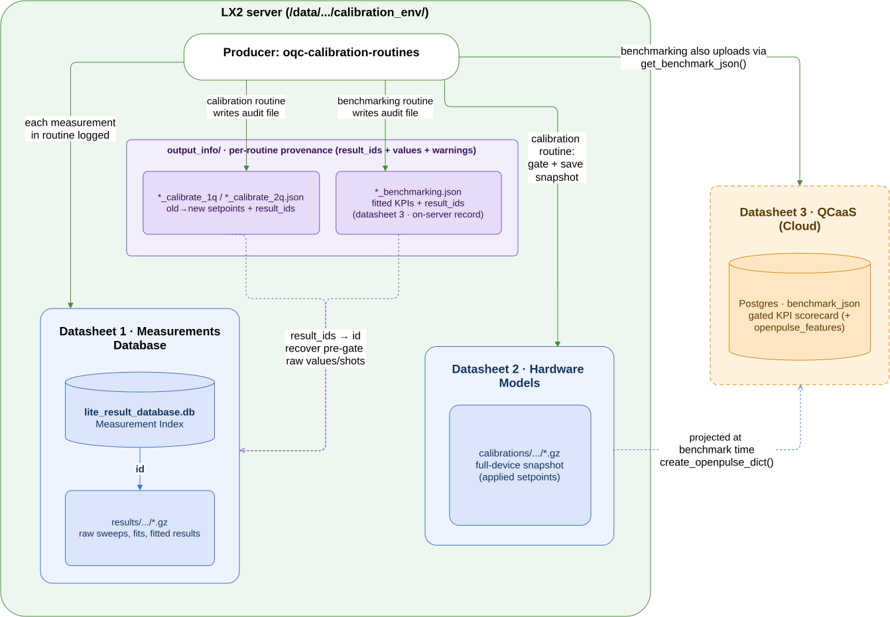
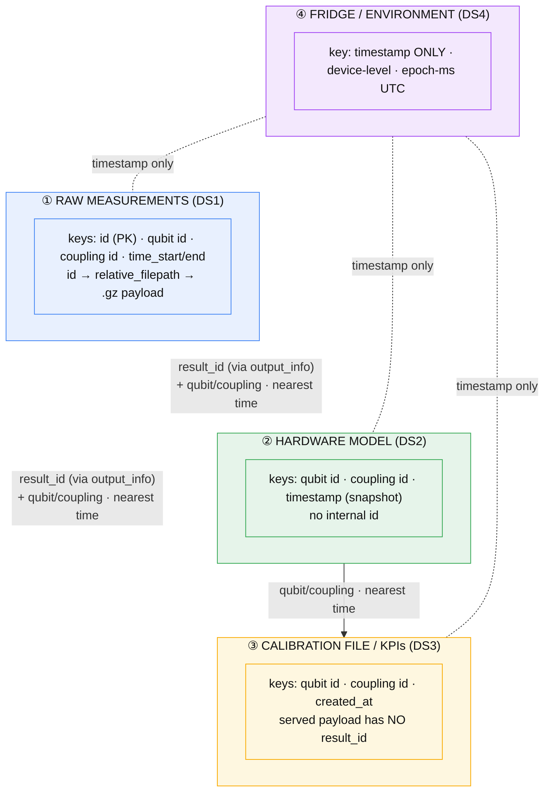
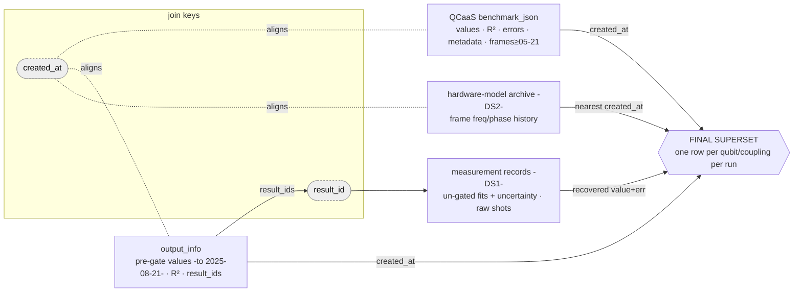

# Phase 00: Data inventory

The aim of this documentation is to have process records - specifically to capture how each source was found and understood since it hadn't been previously indexed. Anyone who needs the context or origin of LX2 data can start here and extend the work from it. Before any analysis can begin, there needs to be a clear picture of what data currently exists, where it resides, and whether it can actually be accessed. No formal data inventory had yet been done, so establishing that mapping is the starting point. 

## Contents

- [Phase 00: Data inventory](#phase-00-data-inventory)
  - [Contents](#contents)
  - [The inventory](#the-inventory)
  - [Retrieving the data](#retrieving-the-data)
    - [DS2) Hardware model: server archive vs Azure blob store (accessible via qupboard)](#ds2-hardware-model-server-archive-vs-azure-blob-store-accessible-via-qupboard)
    - [DS3) Benchmarking files: QCaaS vs the server's raw `output_info`](#ds3-benchmarking-files-qcaas-vs-the-servers-raw-output_info)
  - [Data mapping](#data-mapping)
    - [Join keys](#join-keys)
  - [Logical superset](#logical-superset)
  - [Picking a source for EDA](#picking-a-source-for-eda)
  - [Appendix A: hardware-model source comparison (DS2)](#appendix-a-hardware-model-source-comparison-ds2)
  - [Appendix B: benchmarking source comparison (DS3)](#appendix-b-benchmarking-source-comparison-ds3)
  - [Appendix C: the working-dataset schema](#appendix-c-the-working-dataset-schema)
    - [C.1 Structure](#c1-structure)
      - [Target schema](#target-schema)
      - [Assembly](#assembly)
    - [C.2 Cell semantics](#c2-cell-semantics)
      - [Sources and gating](#sources-and-gating)
      - [Classifying a cell](#classifying-a-cell)
      - [Notes](#notes)

## The inventory

With no prior inventory, most of the early work was provenance: determining which sources exist, where each source lives and how it is produced. This search surfaced four sources - each is summarised in the table below, with a link to its datasheet for the full detail.

| Source | What it is | Where it lives | How to reach it | Copy to trust | Usable span | Clock |
|---|---|---|---|---|---|---|
| [**DS1, Measurements DB**](../datasheets/01_measurements_database.md) | Raw experimental record: one index row plus one `.gz` payload per measurement run.| `calibration_env/lite_result_database.db` index plus `calibration_env/results/YYYY/MM/DD/*.gz` payloads | SSH | Server records, via `result_id` | 2024-09-18 → 2026-08-18 (restore-frozen) | UTC, no timezone in the stamp |
| [**DS2, Hardware Models**](../datasheets/02_hardware_models.md) | Applied control state. Full-device setpoint snapshots. | `calibration_env/calibrations/YYYY/MM/DD/*.gz` dated archive, mirrored to an Azure blob | SSH for the archive, or `qupboard_client` for the live head | Server `.gz` archive | 2025-01-01 → 2026-08-18 | UTC, no timezone in the stamp |
| [**DS3, QCaaS Benchmarking Files**](../datasheets/03_benchmarking_files.md) | Per-qubit and per-coupling KPI scorecard | QCaaS DB, plus raw `output_info/YYYY/MM/DD/*_benchmarking.json` on the server | SDK or REST for the derived scorecard, SSH for the raw `output_info` | SDK for KPIs, `output_info` for provenance | KPIs 2024-05-24 → present. Raw `output_info` 2024-04-15 → 2026-08-17 (57 early files in April-May 2024, then continuous from 2024-10-15). | UTC, no timezone in the stamp |
| [**DS4, Fridge/Environment**](../datasheets/04_fridge_environment.md) | Cryostat telemetry, sampled on a regular 6 h grid | Prometheus time series (fed by the `oqc-watchdog` exporter), surfaced via Grafana. (Local snapshot is a CSV export at `data/raw/fridge_lx2_grafana_20260903.csv`) | Grafana CSV export | Prometheus/Grafana series | 2025-08-01 → 2026-09-03 (13 months) | Epoch-ms UTC |

Note the three in-server sources all sit under one root on the LX2 server, `/data/calibration_restore/oqc_calibration_routines_data/`, so the paths are given relative to it.

> **Note on timestamps:** The `created_at` stamps on DS1-3 carry no timezone, while DS4 is recorded in epoch milliseconds. All four sources are UTC ([Phase 01 A1](01_eda.md#a1-clock)), so joins across them need no offset.

## Retrieving the data

As noted above, some of the sources (the hardware models and benchmarking files in particular) have different possible access paths and, importantly, data coverage and correctness varies across them. Note the conclusions live in the datasheets and the full reproducible logs are in Appendix A for DS2 and Appendix B for DS3. This is a high-level summary:

### DS2) Hardware model: server archive vs Azure blob store (accessible via qupboard)
- **Same content.** The dated `.gz` archive on the LX2 server and the model served by `qupboard_client` (the Azure blob behind it) are byte-identical per snapshot, once the serialisation noise is normalised/accounted for.
- **Different coverage.**
  - *Server archive:* the full dated history. Around 4,603 snapshots, reaching back to 2025-01-01, at roughly eight per day.
  - *Qupboard/blob:* only a shallow backup. The blob store's version trail starts at 2025-11-20, runs at about 4 to 6 uploads per day, and has no version for the two server saves made just before each window starts. A stage uploads only when it ends, so those saves are never uploaded. Note qupboard itself exposes only the current head - so you can't use it to fetch historical hardware models.

**Conclusion:** use the server archive for anything historical, and use qupboard for today's live model. (See section 3 in [Datasheet 2](../datasheets/02_hardware_models.md) and Appendix A.)

### DS3) Benchmarking files: QCaaS vs the server's raw `output_info`

- **Different, complementary content.** QCaaS carries the fit `*_error`, the `general` metadata, and `openpulse_features`. The raw `output_info` carries the `result_ids` and `warnings`, which is the provenance and join layer. Neither is a subset of the other, so the schema needs both.
- **Data correctness:** where QCaaS and the raw `output_info` share fields (the KPI values and their R²), the numbers match. But, there is a difference of when each side nulls: `output_info.benchmarks` holds the producer's pre-gate values, so it can keep a raw value where the served QCaaS payload is nulled - but only in the R²-gated era-1 (2024-09-10 to 2025-07-06). Across the un-gated middle window and the re-gated 2025-08-22+ era the two agree. The earliest served runs, before 2024-09-10, have no `output_info` file to compare with. (Full four-phase breakdown and per-era counts in the gating-over-time note in Appendix C.)
- **The shape varies over time.** The `openpulse_features` block (the frames) only appears from 2026-05-21 onward via QCaaS client. (Note these can be reconstructed from the hardware models/DS2 as described in datasheet 3).
- **Coverage differs.** QCaaS files run from 2024-05-24 to the present. The raw `output_info` run from 2024-04-15 to 2026-08-17 (663 files in total). Those files fall into two parts: 57 early files in April-May 2024, which predate the QCaaS start, and then - after a gap - continuous coverage from 2024-10-15.

**Conclusion:** derived (QCaaS) and raw (`output_info`) are complementary: pull KPIs, metadata and frames from QCaaS, and use the server `output_info` for `result_ids` and `warnings`. (See section 3 in [Datasheet 3](../datasheets/03_benchmarking_files.md) and Appendix B.)

> **Note on environments:**
> - **Qupboard and QCaaS can't share an env:** `qupboard_client` needs Python ≥ 3.13, `oqc-qcaas-client` needs < 3.13. Run Qupboard from a separate `.venv-qupboard`.
> - **maac:** `oqc-maac` forces downgrades on the analysis stack (numpy `1.26` vs `2.2`, matplotlib `<=3.8.3` vs `>=3.9`, plus scipy/notebook). Keep it out of the main env and run it from an isolated `.venv-maac`.

## Data mapping

It is worth mapping the four sources against one another: where each one comes from, how they link to one another, and how they can be joined. Three of the four live on the LX2 server (technically part of the benchmarking source does) and are produced by linked processes, while DS4, the fridge telemetry, comes from elsewhere entirely (a separate Grafana/Prometheus export).

The three in-server sources are connected via the **calibration pipelines**, `oqc-calibration-routines`, which run in two scheduled windows a day on LX2. Those routines orchestrate the schedule, but the measurements themselves - the calibration sweeps that set the hardware model (Rabi, Ramsey, spectroscopy, frequency/DRAG tuning) and the benchmarking characterisations that produce the KPIs (T1, T2-echo, readout, 1Q/2Q RB), along with all their fitting logic - are defined in `oqc-maac`, the measurement library the routines call into. The diagram below shows how that shared producer feeds each of the three sources, and how the `output_info` layer connects them together.



Some key points to note:
- **DS1** is the only place the raw sweeps, shots and fit internals live. It is the measurement record: the raw results that the calibration routines, which consist of an ordered set of measurements, turn into the DS2 setpoints and DS3 KPIs, with every product linking back to them by `result_id`.
- **DS2** keeps the accepted setpoints, together with the full device configuration they sit in. It is a gated, downstream view of those same measurements.
- **DS3** keeps the fitted KPIs, nulled where appropriate (see Appendix C), plus the `openpulse_features` frames from 2026-05-21 on. It is the other gated, downstream view.
- **`output_info`** is written by every routine and is what ties the three back together. Each file records the `result_ids` of the measurements that make up that routine (those ids are exactly DS1 `id`s).
- Therefore, a null KPI is often recoverable by reading that run's `output_info` `result_ids` and opening the DS1 payloads - though this depends on why the cell is null (the `value_status` breakdown is in Appendix C). 
- The `output_info` `*_calibrate_*` files (not DS2) carry the old and new setpoints plus a `result_id` per measured entity, with any out-of-spec step noted in `warnings`. A warning doesn't mean the update was rejected: it names one failed ladder step, and earlier steps can still apply ([Phase 01 A3](01_eda.md#a3-run-map-and-coverage)). Whether an update was applied is resolved by diffing consecutive DS2 snapshots.


DS4 is an independent monitoring stream, sampled on a regular six-hour grid, so it only ever lines up with the rest by time. That grid is actually finer than the roughly twelve-hour calibration cadence, which means there is usually environmental context on either side of any given calibration run.

> **Note on "calibration file":** on the server it is the DS2 hardware model (the product of the calibration routines), but in QCaaS the same phrase means the DS3 daily benchmarking json.


### Join keys

Combining any two sources involves two types of joins. The one exact, true-equality link is `result_id` which connects to the raw measurement in DS1. Everything else is an as-of, nearest-time join, narrowed by qubit or coupling id. Also, as the sources run on different cadences and grains, you would have a time tolerance rather than expect the timestamps to match exactly. The diagram below shows the possible join keys across sources:



> **Note on entity ids:** The entity ids do not match across sources. The same qubit shows up as `&Q1&` in DS1, `Q1` in `output_info`, `1` in DS3 and `index=1` in DS2. Couplings show up as `C1-T10`, `C1_T10`, `1-10` and `direction=(1, 10)`, and they also carry a direction, from control to target. Normalise all of these first (`qpu_drift.ids`), or a plain string join will silently drop rows.

 
## Logical superset

Each source is already its own dataset (its datasheet covers `raw/` through to a cleaned spine) so could be used directly for analysis. For my secondment project, it is worth thinking in terms of the logical superset. That superset builds on the tables [section 6 from Datasheet 3](../datasheets/03_benchmarking_files.md) already defines - the benchmarking run and KPI tables, plus `value_status` - and extends them with the measurement layer's un-gated fits and hardware models' control setpoints. The `created_at` key time-aligns each run across QCaaS, `output_info`, and the hardware-model snapshot, while `result_id` joins `output_info.result_ids` to the DS1 measurement records. Appendix C gives the full schema.

Which source contributes what, and over what window (full-richness window is roughly **2025-01 to 2026-08**):

| Source | What it contributes | Usable span |
|---|---|---|
| QCaaS `benchmark_json` | KPI values, R² and `*_error` (both from ~2025-07), `general` metadata, frames (from 2026-05-21) | 2024-05-24 → present |
| `output_info` (server) | `result_ids`, `warnings`, `fit_quality` (R²) and pre-gate `benchmarks` values (through 2025-08-21) - the provenance layer | 2024-04-15 → 2026-08-17 (restore-frozen; continuous from 2024-10-15) |
| DS1 records (via `result_id`) | un-gated fits, per-KPI uncertainty, raw shots | 2024-09-18 → 2026-08-18 (restore-frozen) |
| DS2 archive | per-channel frequency and phase history (the control setpoints), including pre-2026-05-21 | 2025-01-01 → 2026-08-18 |
| DS4 | environmental context, by timestamp only | 2025-08-01 → 2026-09-03 |

> **Note:** The heavy layers - raw shots, un-gated fits, frame history - aren't built up front. The superset stays a thin spine and pulls them in only when a question actually needs them.


## Picking a source for EDA

As a summary, this covers an overview of existing LX2-related data and which source to pick for anyone wanting to run custom EDA. For the joins, use the exact `result_id` link where possible; otherwise normalise the entity ids first and do an as-of time match with a sensible tolerance.

- **Trending KPIs** (coherence times, fidelities): use DS3, via the QCaaS SDK.
- **Pre-gate raw values, shots or fit internals:** DS1, via SSH to server.
- **Reconstructing applied setpoints or frame/frequency history:** the DS2 server archive. The `output_info` `*_calibrate_*` files hold the before-and-after values.
- **Adding environmental context:** DS4, by timestamp only.

With all four datasheets written ([DS1](../datasheets/01_measurements_database.md), [DS2](../datasheets/02_hardware_models.md), [DS3](../datasheets/03_benchmarking_files.md), [DS4](../datasheets/04_fridge_environment.md)), the sources are fully mapped and documented.

---

## Appendix A: hardware-model source comparison (DS2)

*Reproducible log behind the DS2 verdict in [Datasheet 2 - section 3](../datasheets/02_hardware_models.md). Needs the OQC VPN, Azure access, and SSH to the LX2 tools VM. Verified 2026-09-07.*

<details>
<summary>Full investigation log</summary>

**The two sources**

| # | Source | What it is | Access |
|---|---|---|---|
| A | `calibration_env/calibrations/YYYY/MM/DD/HH-MM-SS_calibration.gz` | dated `.gz` snapshots on the LX2 tools VM | SSH |
| B | Qupboard / Azure blob (`https://qupboard.cloud.int.oqc.app/`) | the current model in blob storage, via `qupboard_client` | `qupboard_client` + Azure auth |

The question I wanted to settle was simple: is B just a copy of A, is it a subset? Or do the two genuinely disagree, and either way which one should we trust?

**Step 1: pull the current model from Qupboard (B).** 

The script (provided in the collapsible below) lists every model summary, filters down to LX2, and (unless you pass `--list-only`) downloads each payload alongside a resumable `manifest.csv` keyed on `content_md5`. It runs from a dedicated `.venv-qupboard/` with `qupboard_client` 0.4.16. (It can't exist in the same env as the QCaaS client so I had to make a separate venv).

```bash
.venv-qupboard/bin/python scripts/fetch_hardware_models.py --list-only     # prod is the default
```

Against prod, this came back with just 2 blobs for the QPU, which is the current head only with no dated history behind it. `get_hardware_model()` doesn't take a date either, so there is nothing to filter on.

**Step 2: inventory source A.** 

Source A is the dated jsonpickle archive, and it is a proper time series. There are 4,603 `.gz` snapshots running from 2025-01-01 to 2026-08-18, one per calibration event. Each one is a full `LiveArbSeqHardwareModel` (32 qubits, 32 resonators, 263 pulse_channels, 64 physical_channels, 64 quantum_devices, and 7 basebands) and decompresses to about 9 MB.

**Step 3: compare them.** 

Observations:

* *Qupboard embeds source A.* The `.json` model is a thin wrapper, `{qpu_id, qubits: 32, hardware_type: "LIVE", calibration_file: "…"}`, and that `calibration_file` string is itself one `LiveArbSeqHardwareModel` with the same `py/state` keys and the same object counts. So the schema matches.
* *What the blob store actually is.* It isn't a database. It overwrites a single live head, and the only history it keeps is under blob *versions*, which only reach back to 2025-11-20. So it's really a backup and distribution layer rather than the primary record.
* *Coverage & Cadence.* A holds the full history, whereas B only gives you the current head plus one legacy blob. The server also writes around 8 snapshots a day, whereas the blob is only uploaded 4 to 6 times a day. So the blob's version trail ends up both shorter and sparser than the server archive.
* *The same-day byte check.* The cleanest test is to line up a blob and a server `.gz` from the same moment. For the blob version stamped `2026-07-31T22:08:26Z`, the server twin is `2026/07/31/22-08-38_calibration.gz`, written 12 seconds later with an identical decompressed length. The raw strings do differ, but this is a serialisation artefact. The `py/obj_ref_id` and `py/id` values are Python `id()` addresses that change from process to process, and `py/set` ordering is non-deterministic. Once you zero the ids and sort every `py/set`, both sides hash to `e1e701ca…`, so the model itself is identical. As an aside, the two server saves each day with no matching blob version are the saves made just before each window starts (about 08:45 and 19:05). A stage uploads only when it ends, so these saves are never uploaded ([Datasheet 2](../datasheets/02_hardware_models.md)).
* *Shape.* The two are the same object field for field. It's worth flagging that the 9 MB file size is misleading, since it's almost all pretty-print whitespace. The real content is closer to **730 KB compact, about 35,000 JSON nodes**:

    | Model | Nodes | Compact chars |
    |---|---|---|
    | server `.gz` (08-46) | 34,993 | 729,671 |
    | server `.gz` (23-01) | 35,241 | 735,474 |
    | qupboard (today) | 35,321 | 737,085 |

    The small differences in node count aren't one source being richer, they're just different snapshots.

**The verdict:** Per snapshot the two are identical, so the choice comes down purely to history, cadence and access, and on all three the server `.gz` archive wins. Reach for Qupboard or the blob only when you want the live model without SSH. Note, for this analysis, I only checked one date rather than every overlapping day.

<details>
<summary>Fetch script: <code>fetch_hardware_models.py</code></summary>

This script fetches hardware models from qupboard. The qupboard API only exposes `get_hardware_model(qpu_id)` with no date parameter, so any historical snapshots have to come through as distinct entries from `list_hardware_models()`. So the script lists every hardware-model summary, filters down to the target QPU (by id and/or name, unless `--all`), downloads each full model, and records a manifest so re-runs skip content already fetched.

A few practical notes on running it:

- It runs from the dedicated `.venv-qupboard/` (`qupboard_client` 0.4.16), since qupboard and the QCaaS client can't share an environment.
- `--list-only` just prints the matching summaries. (Without it, each model is downloaded and a resumable `manifest.csv` (keyed on `content_md5`) lets re-runs skip anything already fetched).
- `--env` switches between the production and development qupboard environments (default `prod`), pinning the base URL and Azure token scope together so their audiences match (mixing them makes Azure return a 403). `--base-url`/`--scope` override either.
- Authentication is interactive: qupboard prints a sign-in URL to open in a browser, and you complete the Azure login there.

```python

import argparse
import csv
import json
import re
import sys
from datetime import datetime, timezone
from pathlib import Path

from qupboard_client.client import QupboardClient
from qupboard_client.exceptions import QupboardApiError, QupboardClientError

# Qupboard (Azure blob store) has two environments. The base URL and the Azure
# token scope (audience) must come from the SAME environment: mixing a prod URL
# with a dev scope makes Azure return 403 "Audiences in Jwt are not allowed".
# The client library's built-in defaults point at dev, so we pin both here and
# expose --env to switch cleanly.
PROD_QUPBOARD_URL = "https://qupboard.cloud.int.oqc.app/"
PROD_QUPBOARD_SCOPE = "api://54c87ede-345c-4b0a-81b2-2aa7e52bc1aa/.default"
DEV_QUPBOARD_URL = "https://development.qupboard.cloud.int.oqc.app/"
DEV_QUPBOARD_SCOPE = "api://67b6ec1f-89ea-41e7-8c74-e812b73a0bcc/.default"

ENVIRONMENTS = {
    "prod": {"base_url": PROD_QUPBOARD_URL, "scope": PROD_QUPBOARD_SCOPE},
    "dev": {"base_url": DEV_QUPBOARD_URL, "scope": DEV_QUPBOARD_SCOPE},
}

DEFAULT_QPU_ID = "qpu:jp:3:673b1ad43c"
DEFAULT_QPU_NAME = "toshiko"


def parse_args(argv: list[str] | None = None) -> argparse.Namespace:
    parser = argparse.ArgumentParser(
        description="Fetch hardware models from qupboard and archive them locally.",
    )
    parser.add_argument(
        "--env",
        choices=sorted(ENVIRONMENTS),
        default="prod",
        help="Qupboard environment to target; sets base URL and token scope together.",
    )
    parser.add_argument(
        "--base-url",
        default=None,
        help="Override the base URL selected by --env.",
    )
    parser.add_argument(
        "--scope",
        default=None,
        help=(
            "Override the Azure token scope (audience) selected by --env. Must "
            "match the target environment's app registration."
        ),
    )
    parser.add_argument(
        "--qpu-id",
        default=DEFAULT_QPU_ID,
        help="Target QPU id to match against summary id/description.",
    )
    parser.add_argument(
        "--name",
        default=DEFAULT_QPU_NAME,
        help="Human-readable QPU name to also match (e.g. 'toshiko').",
    )
    parser.add_argument(
        "--all",
        action="store_true",
        help="Fetch every model on the server, ignoring the qpu-id/name filter.",
    )
    parser.add_argument(
        "--list-only",
        action="store_true",
        help="Only list matching summaries; do not download full models.",
    )
    parser.add_argument(
        "--out-dir",
        type=Path,
        default=Path("data/raw/hardware_models"),
        help="Directory to write downloaded models and the manifest into.",
    )
    parser.add_argument(
        "--overwrite",
        action="store_true",
        help="Re-download models even if their content_md5 is already archived.",
    )
    args = parser.parse_args(argv)
    # Resolve base URL / scope from the chosen environment unless overridden.
    env = ENVIRONMENTS[args.env]
    if args.base_url is None:
        args.base_url = env["base_url"]
    if args.scope is None:
        args.scope = env["scope"]
    return args


def matches(summary, qpu_id: str, name: str) -> bool:
    """Return True if a summary looks like it belongs to the target QPU."""
    haystack = f"{summary.id or ''} {summary.description or ''}".lower()
    return qpu_id.lower() in haystack or (bool(name) and name.lower() in haystack)


def safe_stem(model_id: str, last_modified: datetime | None) -> str:
    """Build a filesystem-safe file stem from an id and timestamp."""
    ident = re.sub(r"[^A-Za-z0-9._-]", "_", model_id)
    stamp = last_modified.strftime("%Y%m%dT%H%M%S") if last_modified else "unknown"
    return f"{ident}__{stamp}"


def load_seen_md5(manifest_path: Path) -> set[str]:
    """Read content_md5 values already recorded in the manifest."""
    if not manifest_path.exists():
        return set()
    with manifest_path.open(newline="") as fh:
        return {
            row["content_md5"]
            for row in csv.DictReader(fh)
            if row.get("content_md5")
        }


def append_manifest(manifest_path: Path, record: dict[str, str]) -> None:
    """Append one row to the manifest, writing a header if the file is new."""
    is_new = not manifest_path.exists()
    with manifest_path.open("a", newline="") as fh:
        writer = csv.DictWriter(
            fh,
            fieldnames=["id", "last_modified", "content_md5", "filename", "fetched_at"],
        )
        if is_new:
            writer.writeheader()
        writer.writerow(record)


def build_client(args: argparse.Namespace) -> QupboardClient:
    return QupboardClient(base_url=args.base_url, scope=args.scope)


def main(argv: list[str] | None = None) -> int:
    args = parse_args(argv)
    args.out_dir.mkdir(parents=True, exist_ok=True)
    manifest_path = args.out_dir / "manifest.csv"
    seen_md5 = set() if args.overwrite else load_seen_md5(manifest_path)

    try:
        with build_client(args) as client:
            summaries = client.list_hardware_models()
            if not args.all:
                summaries = [s for s in summaries if matches(s, args.qpu_id, args.name)]
            summaries.sort(key=lambda s: (s.last_modified or datetime.min))

            print(f"Found {len(summaries)} matching hardware model(s) at {args.base_url}")
            for s in summaries:
                print(f"  {s.id}  modified={s.last_modified}  md5={s.content_md5}")

            if args.list_only or not summaries:
                return 0

            fetched = skipped = failed = 0
            for i, s in enumerate(summaries, start=1):
                if s.content_md5 and s.content_md5 in seen_md5:
                    skipped += 1
                    continue
                try:
                    model = client.get_hardware_model(s.id)
                except (QupboardApiError, QupboardClientError) as exc:
                    print(f"[{i}/{len(summaries)}] FAILED {s.id}: {exc}", file=sys.stderr)
                    failed += 1
                    continue

                out_path = args.out_dir / f"{safe_stem(s.id, s.last_modified)}.json"
                out_path.write_text(json.dumps(model.hardware_model, indent=2))
                append_manifest(
                    manifest_path,
                    {
                        "id": s.id,
                        "last_modified": s.last_modified.isoformat() if s.last_modified else "",
                        "content_md5": s.content_md5 or "",
                        "filename": out_path.name,
                        "fetched_at": datetime.now(timezone.utc).isoformat(),
                    },
                )
                if s.content_md5:
                    seen_md5.add(s.content_md5)
                fetched += 1
                print(f"[{i}/{len(summaries)}] saved {out_path.name}")

            print(f"Done. fetched={fetched} skipped={skipped} failed={failed}")
            return 1 if failed else 0
    except QupboardClientError as exc:
        print(f"Qupboard client error: {exc}", file=sys.stderr)
        return 2
    except KeyboardInterrupt:
        print("Interrupted; progress is saved in the manifest.", file=sys.stderr)
        return 130


if __name__ == "__main__":
    raise SystemExit(main())
```

</details>

</details>

## Appendix B: benchmarking source comparison (DS3)

*Reproducible log behind the DS3 verdict in [Datasheet 3 section 3](../datasheets/03_benchmarking_files.md). Needs the OQC VPN and a valid `OQC_AUTH_TOKEN`. Verified 2026-09-07.*

<details>
<summary>Full investigation log</summary>

**The three places the record comes from**

| # | Source | What it is | Access |
|---|---|---|---|
| A | `output_info/…_benchmarking.json` | the benchmarking run's **raw** output (`result_ids` / `benchmarks` / `fit_quality` / `warnings`) | SSH |
| B | QCaaS SDK, `OQCClient.get_calibration()` | the derived KPI scorecard | `qcaas_client` + token |
| C | QCaaS REST, `GET /monitoring/calibrations` | the same scorecard, over raw HTTP | `requests` + token |


**Step 1: what the SDK actually does (from its source).** In `oqc-qcaas-client 3.22.1`, `get_calibration` resolves the per-QPU url from `get_qpus()` and then hits `{qpu_url}/monitoring/calibrations` with `{qpu_id, date}`, which is exactly the "REST" path. So the SDK is really just a thin wrapper over the same endpoint: one route.

```python
def get_calibration(self, qpu_id=None, date_filter=None):
    params = {"qpu_id": qpu_id}
    if date_filter is not None:
        params["date"] = str(date_filter)
    endpoint = self._get_qpu_endpoint(qpu_id)              # url from get_qpus()
    return self._get(endpoint + "/monitoring/calibrations", params).json()
```

For our QPU that resolves to `https://jp.cloud.int.oqc.app/673b1ad43c`.

**Step 2: pull both ways and hash (latest, 2026-09-07).** Pulled via the SDK and via REST, both come back the same: a 264-frame payload stamped `created_at 2026-09-04 22:00:32`, at 57,472 compact characters, sha256 `bddfc886…`. So they're byte-identical. Note these figures are specific to that day's latest run.

**Step 3: frames come back in full on every path.** As of 3.22.1 the SDK and REST both return `openpulse_features` whenever the payload carries them. 

**Step 4: cross-date behaviour** (identical on every path):

- *Forward-fill.* A given date returns the latest record created strictly before 00:00 that day, so dedup by `created_at`.
- *Frames onset.* The last frames-less payload is `2026-05-18 23:04:22` and the first with frames is `2026-05-21 23:00:56` (263 of them), which makes 2026-05-21 the exact first frame-carrying run.
- *History floor.* Nothing is served before `2024-05-24 20:16:42`, so roughly 27.5 months of history.
- *Frame growth.* The count sits flat at 263 from 2026-05-21 to 2026-08-31, then goes up to 264 on 2026-09-01 when `q7_freq_shift` is added. This date comes from the downloaded raw files; the probe first saw 264 frames on 2026-09-04.

**Step 5: `output_info` versus the SDK/API:** B and C are the derived scorecard, whereas A is the raw origin they're built from, `{result_ids, benchmarks, fit_quality, warnings}`, reshaped by `get_benchmark_json()`. Note the `output_info` archive runs 2024-04-15 to 2026-08-17 (57 early files in April-May 2024, a gap, then continuous from 2024-10-15 - as discussed in the "Retrieving the Data" section). Field by field:

| `output_info` (raw) | `benchmark_json` (QCaaS) | relationship |
|---|---|---|
| `benchmarks.{t1s, t2s, fidelities_*}` | `one_qubit[n].{T1, T2, fRB, fRO}`, `two_qubit.fCX` | Agree everywhere except **era 1** (2024-09-10 to 2025-07-06), where `output_info` holds the raw **pre-gate** value where QCaaS is gated to `null` |
| `fit_quality.*` | `*_r2` | Identical where both exist. QCaaS `*_r2` is absent before ~2025-07 (`output_info.fit_quality` present from 2024-04-23) |
| *(computed at runtime)* | `*_error` | **QCaaS only**, not persisted on server |
| *(filename date)* | `general.created_at` | `output_info` dated by path, no field |
| *(none)* | `general` metadata, `openpulse_features` | **QCaaS only** |
| `result_ids`, `warnings` | *(dropped)* | **`output_info` only**, the join key plus notes |

So, although in general agreement in terms of data correctness, neither is a subset of the other. Note also frames aren't in `output_info` at all but they're derivable from the DS2 archive instead, which is roughly 16½ months of pre-2026-05-21 frame history that the QCaaS record never held. The per-channel `frequency` reads straight off each `PulseChannel`, and the frame `phase` is just a hardcoded `0`.

**The verdict.** B and C are one store. The real split is derived (QCaaS) versus raw (`output_info`). Prefer the SDK, and only use `output_info` plus `results/*.gz` when you actually need the pre-gate raw values. The full reasoning is in [Datasheet 3 section 3](../datasheets/03_benchmarking_files.md).

<details>
<summary>Probe script: <code>probe_sdk_vs_api.py</code></summary>

A standalone script that reads `.env` directly. Run `python probe_sdk_vs_api.py` to probe the latest calibration, or pass a date (e.g. `python probe_sdk_vs_api.py 2026-06-01`) to target a specific run. Requires the OQC VPN and a valid `OQC_AUTH_TOKEN` in `.env`.

```python
import hashlib
import json
import os
import sys
from pathlib import Path

import requests

ROOT = Path(__file__).resolve().parents[1]
SAMPLES = Path(__file__).resolve().parent / "samples"


def load_env(path: Path) -> dict[str, str]:
    """Minimal .env reader (no dependency on python-dotenv or the wrapper)."""
    env: dict[str, str] = {}
    if not path.exists():
        return env
    for line in path.read_text().splitlines():
        line = line.strip()
        if not line or line.startswith("#") or "=" not in line:
            continue
        k, v = line.split("=", 1)
        env[k.strip()] = v.strip().strip('"').strip("'")
    return env


def summarise(label: str, payload) -> dict:
    """Reduce a payload to the facts we care about, without trusting its shape."""
    info: dict = {"label": label, "python_type": type(payload).__name__}
    if not isinstance(payload, dict):
        info["note"] = f"non-dict payload: {repr(payload)[:120]}"
        return info
    keys = sorted(payload.keys())
    info["top_level_keys"] = keys
    info["has_openpulse_features"] = "openpulse_features" in payload
    op = payload.get("openpulse_features")
    if isinstance(op, dict):
        frames = op.get("open_pulse", {}).get("frames")
        info["frame_count"] = len(frames) if isinstance(frames, dict) else None
    info["created_at"] = payload.get("general", {}).get("created_at") if isinstance(
        payload.get("general"), dict
    ) else None
    info["one_qubit_n"] = len(payload.get("one_qubit", {})) if isinstance(
        payload.get("one_qubit"), dict
    ) else None
    info["two_qubit_n"] = len(payload.get("two_qubit", {})) if isinstance(
        payload.get("two_qubit"), dict
    ) else None
    compact = json.dumps(payload, sort_keys=True, separators=(",", ":"))
    info["compact_chars"] = len(compact)
    info["sha256_sorted"] = hashlib.sha256(compact.encode()).hexdigest()[:16]
    return info


def dump(label: str, payload) -> None:
    SAMPLES.mkdir(parents=True, exist_ok=True)
    (SAMPLES / f"{label}.json").write_text(json.dumps(payload, indent=2))


def main() -> None:
    env = load_env(ROOT / ".env")
    token = env.get("OQC_AUTH_TOKEN") or os.environ.get("OQC_AUTH_TOKEN")
    url = env.get("OQC_URL", "https://cloud.int.oqc.app/")
    qpu_id = env.get("OQC_QPU_ID", "qpu:jp:3:673b1ad43c")
    date_filter = sys.argv[1] if len(sys.argv) > 1 else None

    if not token:
        sys.exit("No OQC_AUTH_TOKEN in .env — cannot probe the live services.")

    print(f"url={url}  qpu_id={qpu_id}  date_filter={date_filter or 'latest'}\n")

    from qcaas_client.client import OQCClient

    client = OQCClient(url=url, authentication_token=token)

    # resolve the QPU record the SDK will target
    qpus = client.get_qpus()
    rec = next((q for q in qpus if q.get("id") == qpu_id), None)
    print("QPU record from get_qpus():")
    print(json.dumps(rec, indent=2), "\n")
    qpu_url = rec["url"] if rec else None

    results = []

    # A. SDK path 
    try:
        sdk_payload = client.get_calibration(qpu_id=qpu_id, date_filter=date_filter)
        dump("A_sdk", sdk_payload)
        results.append(summarise("A_sdk (client.get_calibration)", sdk_payload))
    except Exception as e:  # noqa: BLE001
        results.append({"label": "A_sdk", "error": f"{type(e).__name__}: {e}"})

    # B. raw REST against the SAME endpoint the SDK resolved
    session = requests.Session()
    session.headers.update({"authentication-token": token})
    if qpu_url:
        endpoint = f"{qpu_url.rstrip('/')}/monitoring/calibrations"
        base_params = {"qpu_id": qpu_id}
        if date_filter:
            base_params["date"] = str(date_filter)
        try:
            r = session.get(endpoint, params=base_params, timeout=30)
            r.raise_for_status()
            payload = r.json() or {}
            dump("B_rest", payload)
            results.append(summarise(f"B_rest  ({r.url})", payload))
        except Exception as e:  # noqa: BLE001
            results.append({"label": "B_rest", "error": f"{type(e).__name__}: {e}"})

    # report
    print("=" * 70)
    for s in results:
        print(json.dumps(s, indent=2))
        print("-" * 70)

    # quick equivalence verdicts
    by = {s["label"].split()[0]: s for s in results if "error" not in s}
    if "A_sdk" in by and "B_rest" in by:
        same = by["A_sdk"].get("sha256_sorted") == by["B_rest"].get("sha256_sorted")
        print(f"SDK == REST (sorted payload):  {same}")


if __name__ == "__main__":
    main()
```

</details>

</details>

## Appendix C: the working-dataset schema

*The cross-source superset introduced in [Logical superset](#logical-superset). Complements the single-source run/KPI tables in [Datasheet 3 section 6](../datasheets/03_benchmarking_files.md).*

<details>
<summary>Structure (schema · assembly) · cell semantics (gating · classification)</summary>

### C.1 Structure

#### Target schema

One row per qubit/coupling per run - the **wide, logical** superset that folds every source into a single element-row. Producer *warning* strings are not stored as their own column - once `value_status` is computed they are redundant, because the warning is precisely the signal that separates `no_fit` from `no_result` for a padded null (see [DS3 §6](../datasheets/03_benchmarking_files.md#6-preprocessing-and-cleaning)).

| Column group | Fields | Source | Join key | Notes |
|---|---|---|---|---|
| KPI value | `value` (+ `value_source`) | QCaaS → `output_info.benchmarks` → DS1 (coalesced) | `created_at` / `result_id` | The value is **coalesced** across stores and `value_status` re-derives the **non-monotonic** gate intrinsically from `(metric, value, r2)`, never the served null. **NaN when no store held a value** (never `0`). The per-store gating timeline (and where each value is recovered from) is in C.2 'Sources and gating'. |
| Value provenance | `value_source` ∈ {`qcaas`, `output_info`, `ds1`, `none`} | derived | n/a | Which store supplied the coalesced value. `none` ⟺ the value is NaN. `ds1` marks an era-3 reject refilled on demand and **never** labels an `ok` cell. |
| Gating era | `gating_regime` ∈ {`era0_ungated`, `era1_filter`, `era2_ungated`, `era3_postproc`} | derived from `created_at` (**`runs`** grain) | `created_at` | Run-level explainer of how each store gated the value/R². It implies which store the resolved R² came from (era1 → `output_info`, era2/3 → QCaaS, era0 → neither), so **no separate `r2_source` is kept**. |
| Fit quality | `*_r2` → `r2` (resolved) | `output_info.fit_quality` (full history bar the 8 bring-up files 2024-04-15…22) or QCaaS (`*_r2` only from ~2025-07) | `created_at` | `fRO` doesn't have this. The served QCaaS `*_r2` is a byte copy of `output_info.fit_quality` - the producer writes the same in-memory fit dict to both - so where both exist they are **identical**. `output_info` matters only pre-~2025-07, where it is the **sole** source of R² (nothing is served). The `r2` column is **resolved shallow** (served → `output_info`); which store it came from is implied by `gating_regime`. |
| Fit errors | `*_error` | QCaaS payload (served, ~2025-07+) **or DS1 records** (`<metric>_err` / `fidelity_uncertainty`, all eras) | `created_at`/`result_id` | This is absent from `output_info`. The DS1 copy is verified present back to the earliest 2024-10-15 records |
| Recovery key | `result_id` | `output_info` | n/a | The DS1 join key, used to pull a rejected or failed cell's raw value from the measurement records. Per cell only for `fRB`/`fCX`; `T1`/`T2` carry one id per qubit group, resolved to the qubit at decode ([DS3 §6](../datasheets/03_benchmarking_files.md#6-preprocessing-and-cleaning)). |
| Measurement time | `measured_at` (the run's start) | `output_info` file path | `created_at` (as-of) | The benchmarking run's start stamp, filled alongside `result_id` on matched runs ([DS3 §6](../datasheets/03_benchmarking_files.md#6-preprocessing-and-cleaning)) |
| Control snapshot | per-qubit drive/measure/LO `frequency` (± `phase_offset`) | DS2 archive | nearest `created_at` | read `PulseChannel.frequency` directly from the decoded `hardware_model_values` table |
| Metadata | `max_shots, native_gates, version` (const). `topology` (varies) | QCaaS only | `created_at` | For constants, go to datasheet 3. For `topology`, go to run table |
| On-demand recovery (DS1) | the era-3 reject **value** (+ uncertainty); raw shots/IQ for total fit-failures | DS1 records/`results/*.gz` (value also in `output_info` **pre-2025-08-22**) | `result_id` | The **value-consistency tier** (`value_source = ds1`): eras 1-2 keep a reject's raw value (in `output_info` pre-gate, or served raw), but from **2025-08-22** both stores null it, so `value` would carry a temporal hole. DS1 refills the **5,491** era-3 rejects that have an `output_info` `result_id` pointer (per-element for fRB/fCX, group for T1/T2). The **385** era-3 rejects in the tail month (2026-08-19…09-14, past the `output_info` cache; [DS3 §6](../datasheets/03_benchmarking_files.md#6-preprocessing-and-cleaning)) have no pointer and stay `value_source = none` - recover them by pulling that tail's `output_info`, as with `unresolved`. DS1 never touches an `ok` cell. Uncertainty and raw shots are always DS1-only. |

#### Assembly



### C.2 Cell semantics

#### Sources and gating

**Gating changes over time** 

The two stores were each gated differently over time, and neither did it in a single consistent way, so it's worth being explicit about both. `output_info.benchmarks`, which is the producer's raw fit dict, was written **un-gated** through 2025-08-21: low-R² and out-of-physical-range values were kept as-is. For that ~16-month span the gate-rejected value can be read straight back out of `output_info`, and only the error has to come from DS1. From **2025-08-22** the producer started nulling those values in place before `output_info` is even saved (this is the new `post_process_benchmark`). So from that date on `output_info.benchmarks` is gated exactly like the served QCaaS payload, and the value has to be recovered through DS1 via `result_id`.

The **served** QCaaS payload has its own separate history, in four phases - recorded per run as **`gating_regime`**. Before **2024-09-10** (`era0_ungated`) the producer had no gate at all: values were served raw, with no R² in either store ([DS3 §6](../datasheets/03_benchmarking_files.md#the-shared-gate)). From then through **2025-07-06** (`era1_filter`), `get_benchmark_json` nulled each value with a local `filter()` helper that only checked R² (no range clamp, and no `*_r2` emitted). From **2025-07-07 to 2025-08-21** (`era2_ungated`) that `filter()` was effectively dead, so raw values were served un-gated and now carried `*_r2` and `*_error`. From **2025-08-22** (`era3_postproc`), `post_process_benchmark` re-gates in place, this time on both R² **and** range. So served gating is **non-monotonic**, and `*_r2` only appears in the payload from `era2` onward. On the 655 runs these eras split **75 / 223 / 40 / 317** ([DS3 section 6](../datasheets/03_benchmarking_files.md#level-2-provenance-combined-values-and-recovery)).

This all shows up cleanly in the raw files if you count the cells where QCaaS is null but `output_info` still has a value: **1,812** through `era1` (`era0` has no `output_info` to hold one), then **0** across the un-gated middle window (`era2`, where the shared cells match 100%), and **0** again from `era3` on (both stores null together once the gate deploys).

In the built table the coalesce is recorded by `value_source` - **qcaas 88,689 · output_info 1,812 · ds1 5,491 · none 8,808** - which crossed with `gating_regime` tells the whole story at a glance (era1 draws its recovered values/R² from `output_info`, the ungated middle is pure QCaaS, and only era3 needs the DS1 fill):

| `gating_regime` | `qcaas` | `output_info` | `ds1` | `none` |
|---|---:|---:|---:|---:|
| `era0_ungated` + `era1_filter` (75 + 223 runs) | 39,285 | 1,812 | 0 | 6,583 |
| `era2_ungated` (40) | 6,232 | 0 | 0 | 168 |
| `era3_postproc` (317) | 43,172 | 0 | 5,491 | 2,057 |

#### Classifying a cell

Every cell carries a semantic label, **`value_status`** ∈ {`ok`, `out_of_range`, `low_r2`, `no_fit`, `no_r2`, `no_result`, `unresolved`}. Six states describe a fit the producer actually placed; the seventh, `unresolved`, is a holding state for a padded null whose run is absent from the `output_info` cache. The label is derived by re-applying the physical gate to the resolved `(metric, value, r2)` - **not** to whether the served cell is null (pre-2025-08-22 payloads serve gate-violating fits *with* a value). The resolved-R² step, the `gate()`/`classify()` rule and its ordering, the two `no_fit` spellings, and the per-metric producer behaviour are the calibration datasheet's job and live in **[Datasheet 3 section 6](../datasheets/03_benchmarking_files.md#6-preprocessing-and-cleaning)**; this appendix only reports how the assembled superset populates the seven states.

On the 655 runs (104,800 cells) the states populate as below (see [DS3 section 6](../datasheets/03_benchmarking_files.md#6-preprocessing-and-cleaning) for each state's definition, recoverability, and the `no_fit`-vs-`no_result` warning discriminator):

| `value_status` | Population | Per-metric breakdown |
|---|---:|---|
| `ok` | 78,590 | - |
| `out_of_range` | 1,852 | T2 1,253 · T1 560 · fCX 38 · fRB 1 (1,813 coherence times; 39 fidelities served un-gated, in era 0 and the two `fCX` just above 1 on the 2025-11-08 record, [DS3 §3](../datasheets/03_benchmarking_files.md#3-provenance-and-collection)) |
| `low_r2` | 7,137 | T2 2,740 · fRB 1,936 · fCX 1,598 · T1 863 |
| `no_fit` | 18 | all `fCX`: `r2 == 0` RB2q fits, or nulls settled by an `output_info` no-fit warning |
| `no_r2` | 8,777 | in-range fit values never R²-checked: 8,422 era-0 · 319 Q1/Q2 `T1`/`T2` in 2025-04…07 · 36 on 2025-11-08 |
| `no_result` | 7,041 | qubit 6,194 (T1 2,571 · T2 2,571 · fRB 969 · fRO 83) · coupling `fCX` 847 (incl. the 19 era-0 `fCX` = 0 cells for couplings that were never measured) |
| `unresolved` | 1,385 | T2 427 · fCX 379 · fRB 318 · T1 167 · fRO 94 |

By provenance (`value_source`) the same 104,800 cells split - every `ok` value is served (`qcaas`) on this pull (the `output_info` and `ds1` recovery tiers never land an `ok`), the `ds1` fill only ever lands on a reject, and `none` ⟺ a NaN value:

| `value_source` | `ok` | `low_r2` | `out_of_range` | `no_fit` | `no_r2` | `no_result` | `unresolved` | total |
|---|---:|---:|---:|---:|---:|---:|---:|---:|
| `qcaas` | 78,590 | 522 | 781 | - | 8,777 | 19 | - | 88,689 |
| `output_info` | - | 1,810 | - | 2 | - | - | - | 1,812 |
| `ds1` | - | 4,440 | 1,051 | - | - | - | - | 5,491 |
| `none` | - | 365 | 20 | 16 | - | 7,022 | 1,385 | 8,808 |

#### Notes

* **`unresolved` is limited by the join, not the cells.** A cell only stays `unresolved` when its whole run is missing from the `output_info` cache (663 files to the table's 655 runs, over a narrower window), so match at run level before resolving. On the current pull **1,385** cells stay `unresolved`; the six placed states sum to 103,415, and 103,415 + 1,385 = 104,800 (655 × 160), so everything is accounted for.
* **Usability vs. physicality** (reasoning in [DS3 sections 6-7](../datasheets/03_benchmarking_files.md#6-preprocessing-and-cleaning)). `value_status` - not `value.isna()` - is the authoritative "is this usable?" axis: a served `value == 0` on a fit metric is a placeholder, not a result (→ `no_result` for the 19 era-0 `fCX` = 0 cells, whose couplings were never measured; `no_fit` only when it comes with an R²), an absent value is `NaN` (never `0`), `fRO` is decided on **range alone** so it only ever lands `{ok, no_result, unresolved}` here, and `out_of_range` is almost all coherence times (only 39 of 1,852 are fidelities).
* **An in-range value with no R² is `no_r2`, not `ok`.** Only era 1 can pass one on range, because its producer R²-gated every value upstream. All of `era0`, the Q1/Q2 `T1`/`T2` cells in 2025-04…07 whose `output_info` `fit_quality` is empty, and the 2025-11-08 record were never R²-checked, so they are kept out of the good set - which leaves no good fit metric before 2024-10-15. The cohorts, their cause and the DS1 payload re-check are in [DS3 §6](../datasheets/03_benchmarking_files.md#the-shared-gate).

</details>
