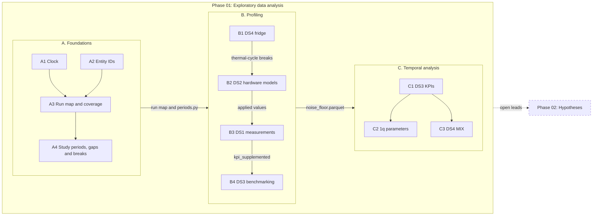

# Phase 01: Exploratory data analysis

[Phase 00](00_data_inventory.md) mapped the four sources. This phase describes what they contain and how their values change over time. It doesn't test hypotheses: [Phase 02](02_hypotheses.md) tests the ones this phase raises. The [findings](../findings.md) page summarises both phases.

## Contents

- [Phase 01: Exploratory data analysis](#phase-01-exploratory-data-analysis)
  - [Contents](#contents)
  - [Approach](#approach)
  - [Plan](#plan)
  - [A. Foundations](#a-foundations)
    - [A1. Clock](#a1-clock)
    - [A2. Entity IDs](#a2-entity-ids)
    - [A3. Run map and coverage](#a3-run-map-and-coverage)
    - [A4. Study periods, gaps and breaks](#a4-study-periods-gaps-and-breaks)
  - [B. Profiling](#b-profiling)
    - [B1. DS4 fridge](#b1-ds4-fridge)
    - [B2. DS2 hardware models](#b2-ds2-hardware-models)
    - [B3. DS1 measurements](#b3-ds1-measurements)
      - [B3a. Activity and linkage](#b3a-activity-and-linkage)
      - [B3b. Sweep settings](#b3b-sweep-settings)
      - [B3c. 1q noise](#b3c-1q-noise)
      - [B3d. KPI payloads](#b3d-kpi-payloads)
    - [B4. DS3 benchmarking](#b4-ds3-benchmarking)
  - [C. Temporal analysis](#c-temporal-analysis)
    - [C1. DS3 KPIs over time](#c1-ds3-kpis-over-time)
    - [C2. 1q parameters over time](#c2-1q-parameters-over-time)
    - [C3. DS4 MIX over time](#c3-ds4-mix-over-time)
  - [Working rules](#working-rules)

## Approach

The aim is to find which questions this data can answer, and which it can't. Three properties of the data shape the approach:

- **The data comes from a control loop.** The routines measure, fit a correction and then decide whether to accept it. DS1 holds what each measurement saw, DS2 what the controller accepted, and DS3 how the device performed straight after recalibration. So a missing or unchanged value often means "rejected", not "missing at random". DS3 never measures the drifted device.
- **The process changes, not only the physics.** Code releases, gating rules, sweep settings, topology and thermal cycles can all shift the data. Each profile looks for these breaks, finds their cause where it can, and splits the data at them.
- **Noise comes before drift.** A trend means little without the noise on a single measurement, so every variable gets a noise estimate first.

Three checks follow from this, and later sections use them by name:

- **Signal ratio.** The variance of the lag-$L$ difference divided by what noise alone would give. With an independent noise estimate $\sigma$ that is $2\sigma^2$. Without one, it's the shortest-lag difference variance, which makes the ratio a lower bound. Noise alone gives 1, and we read 2 or more as signal.
- **Blocks.** Slowly varying series get their sample size from independent blocks. A block is at least as long as the lag where the structure function stops rising. We want 30 or more.
- **Censoring.** The share of an entity's values that the routine rejects or DS3 gates out. Above 10%, we drop the entity or model the censoring.

## Plan

Stage A builds the shared tables that every analysis joins on. Stage B profiles each source and estimates its noise. Stage C describes how the variables with a clear signal change over time. The questions that stages B and C leave open become the leads for Phase 02.

The diagram reads left to right, one box per stage. Within a stage, read top to bottom. Arrow labels name what one step passes to the next. C2 and C3 reuse C1's methods.

| Stage | Goal | Notebooks |
|---|---|---|
| A. Foundations | Shared tables that every later stage joins on | [00_foundations/](../../notebooks/00_foundations/) |
| B. Profiling | One profile and noise estimate per source | [01_profiling/](../../notebooks/01_profiling/) |
| C. Temporal analysis | Drift, steps and change points, for variables with a clear signal | [02_temporal/](../../notebooks/02_temporal/) |

<b>Why the profiles run in the order DS4, DS2, DS1, DS3</b>

- **DS4 first.** It's quick and independent, and its thermal cycles mark breaks that the other sources split at.
- **DS2 next.** It gives the applied values and the controller's step sizes, which B3 compares with measurement noise.
- **DS1 then.** It gives the 1q noise estimates and, through B3d, `kpi_supplemented`: the payload fits and errors that DS3 lacks.
- **DS3 last.** It reads `kpi_supplemented`, because DS3's own `*_error` fields only start in 2025-07. Before that, the payload fit errors stand in.

Each profile writes its own rows to `noise_floor.parquet`.

> [!NOTE]
> **Section layout.** Each notebook section gives the question and the outcome. A collapsed **Key numbers** table holds the numbers, with the notebook section that prints each one. **Open** lists what the notebook couldn't answer. The rules that later work follows are in [working_rules.md](../working_rules.md). Each rule there names the section it comes from.

## A. Foundations

Every analysis joins sources together, so the joins have to be right first. Stage A asks four questions. Do all timestamps share a clock (A1)? Do the qubit and coupling IDs mean the same thing everywhere (A2)? Can each routine run be traced through every source (A3)? When does each source have data, and where did the process change (A4)?

### A1. Clock

**Notebook:** [a1_clock](../../notebooks/00_foundations/a1_clock.ipynb)  
**Question:** are all sources on the same clock?

**Outcome.** Every source is on UTC. DS1, DS2 and DS3 timestamps have no timezone, and DS4 is exported as epoch ms. File header times match the file names read as UTC, with no seasonal shift. DS3 runs end a couple of seconds after their last DS1 row, and run-map starts come just before their first DS1 row. One `benchmarking` file is the exception: it was saved again the morning after its evening run.

<b>Key numbers</b>

| Check | Result |
|---|---|
| Gzip header time against file name, DS2 and raw Ramsey | all 7,104 files match, with no seasonal shift |
| DS1 Ramsey end time against file stamp | 2,525 of 2,525 equal |
| DS3 `created_at` against the last DS1 `RandomizedBenchmarking2q` `time_end` before it | 563 of 580 within 600 s; median 1.68 s behind in summer, 1.82 s in winter. The other 17 come after DS1 ends (16) or after a benchmarking run with no DS1 rows (1) |
| Run-map start (`output_info` file name) against its first linked DS1 row | median 0.01 to 0.18 min earlier, in both seasons |
| Exception | the `benchmarking` file of 2025-08-22 08:26:52 (−735.21 min), saved again the morning after its evening run ([datasheet 3, section 6](../datasheets/03_benchmarking_files.md#6-preprocessing-and-cleaning)) |

### A2. Entity IDs

**Notebook:** [a2_entity_ids](../../notebooks/00_foundations/a2_entity_ids.ipynb)  
**Question:** do qubit and coupling IDs mean the same thing in every source and over time?

**Outcome.** The IDs match across sources and stay stable over time, so sources join on them directly. DS1, DS2 and DS3 use the same 32 qubits. `output_info` adds Q8, but only in its first `calibrate_1q` file, which looks like a pre-production run. Couplings are directed. There's no sign of a chip change, or of a recalibrated swap between qubits more than 10 MHz apart. We test this on the drive frequency in use, which sits on f01 while the calibration tracks the qubit. The f01 order barely moves, and the whole chip shifts by more than 5 MHz only in two episodes (2026-03 and 2026-07). Q23 is the one qubit whose value moves far on its own, for a month in 2025. Nothing moves with it and its readout frequency stays the same, so it's still the same qubit. The size of the move and its run-by-run walk mean the calibration lost the qubit, not that the qubit moved. Its level does change by about 15 MHz across that month, and A2 can't say why.

<b>Key numbers</b>

| Check | Result |
|---|---|
| Qubits in DS1, DS2 and DS3 | 32: IDs 1 to 35 without 3, 8 and 29 |
| Q8 | only in the first `calibrate_1q` file (2024-03-21). Q8 isn't an old name for Q30: it couples to Q5 and Q15, while Q30 only couples to Q31 |
| Couplings | DS3's 35 directions are all among the 39 that `output_info` calibrates; DS2 has those 39 plus 29 one-row extras |
| f01 order | median rank correlation 0.998 across 1,297 `calibrate_1q` runs (2024-04-12 to 2026-08-18) |
| f01 flag windows (`F01_FLAGS`) | Q23 from 2025-03-24 19:44 to 2025-04-25 12:13; every qubit from 2026-03-09 19:42 to 03-24 14:45 and from 2026-07-02 19:38 to 07-05 21:54 (shifts down to −59.3 and −58.2 MHz) |
| Q23 | drive frequency up to 754 MHz off in 2025-03/04, walking a median 11.1 MHz per run; 4303.0 MHz before and 4287.5 MHz after; only 4 measured f01 values before 2025-02-13 |
| Blind spots | a swap between qubits under 10 MHz apart (32 of the 496 pairs) wouldn't show. Q2 and Q13 are measured in only 0.3% of runs, so for them there's only the readout check, which stops at 2026-03-30 |

### A3. Run map and coverage

**Notebook:** [a3_run_map_coverage](../../notebooks/00_foundations/a3_run_map_coverage.ipynb)  
**Question:** can each routine run be traced through DS1, DS2 and DS3, and do the values agree along the way?

`uv run build-run-map` links each `output_info` file to the DS1 ids it claims, the DS2 snapshots before and after it and, for benchmarking, its DS3 run. The tables are written to `data/derived/run_map/`.

**Outcome.** The links are correct. From 2025-01-01 every run traces to DS1 and DS2, and most benchmarking runs trace to DS3. From 2024-09-18 only DS1 and DS3 link, and before that nothing links. Where values can be compared, they agree along the chain. Served R² matches the linked benchmarking file every time and the file before it never, so the DS3 link pairs the right files. Two cautions follow. A warning isn't a rejection, and Ramsey `new` is the applied f01 only when the run has no FineFrequency step for the qubit.

<b>Key numbers</b>

| Check | Result |
|---|---|
| Benchmarking runs that trace to DS3 | 92.4% |
| `output_info` against DS2 | 1q 100%, 2q 99.94%, mixer 98.8 to 100% |
| Ramsey `old` against `output_info` | all 36,918 fits match |
| DS3 frames against DS2 | all 69 comparable runs match |
| DS2 changes on a run's `snap_after` | 99.1 to 99.5% |
| Ramsey `new` equal to the applied f01 | 983 of 36,918 fits (no FineFrequency step); otherwise off by a median 2.6 kHz, up to 581.2 kHz |
| DS1 rows claimed by `valid` ids | 53.7%: none of the mixer sub-steps or readout types, and 59.8% of `CRUnitaryIZ` |
| Files with no `result_ids` | 25 2q, 20 1q, 6 benchmarking and 1 mixer |
| Benchmarking runs with no DS3 run | 38 on days with no linked DS3 run, plus 3 reruns on a day that has one. Their fits look much like the linked ones, but six have over half their R² below 0.9 (2026-03-09/10 and 2026-07-02 to 07-05). Frames are only checked up to the last DS2 snapshot (2026-08-18) |

<b>What "attempted" rules out</b>

- Rows with no id and no warning: 816 to 819 per 1q param, and 2,549 2q amp rows. 22,693 accepted 2q amplitudes are also unchanged.
- 1q rows in the run with no step id and no warning (2,972 drag, 2,786 freq, 648 amp). 5,487 of the drag and freq rows are on qubits with a `freq_shift` step (Q2, Q13, Q23 up to 2025-02-04, and Q35), and 589 of the amp rows are Rabi-only. 330 are unexplained.
- Measured 1q amp and drag always change.

**Open.** Why do the 38 benchmarking runs have no DS3 run: upload or fetch?

### A4. Study periods, gaps and breaks

**Notebook:** [a4_windows_breaks](../../notebooks/00_foundations/a4_windows_breaks.ipynb)  
**Question:** when does each source have data, and where did the process change?

Each source covers its own time span, with gaps. A few process changes (a new routine version, a new DS3 gate, a reversed coupling) can shift a series with no physics behind them. A4 finds both and records them in [periods.py](../../src/qpu_drift/periods.py). `within()` filters to a period, `segment()` splits at breaks, and `spans()` finds differences that cross an untracked DS2 write.

**Outcome.** The study period depends on the sources in use. Three outages stop every routine, and each source also has its own gaps. Reduced runs and most untracked DS2 writes look like breaks but aren't. The end of each 2025 outage is a break: the machine restarted on values no tracked run wrote, and there's no fridge record to say what changed. Every period, outage, DS4 gap, break and large untracked write in `periods.py` matches the data (section 6).

| Sources | Study period |
|---|---|
| All four (with the fridge) | 2025-08-01 to 2026-08-18 |
| DS1, DS2 and DS3 | 2025-01-01 to 2026-08-18 |
| DS1 and DS3 | 2024-10-15 to 2026-08-18 |
| DS3 alone | 2024-05-24 to 2026-09-14 |

<b>Outages, gaps and untracked writes</b>

- **Outages.** Three stop every routine: 2025-02-05 to 02-11, 2025-03-10 to 03-17 and 2026-03-12 to 03-23. DS1 and DS3 have nothing inside them, and DS2 only a few rows. Each 2025 outage ends with an unmatched DS2 write just before the first run back. The 2026 outage is followed by a DS2 rollback (2026-03-24 12:03) and two couplings reversing.
- **Other gaps.** DS3 has its own gaps, the longest from 2024-08-18 to 10-14 (58 days). DS1 is missing 2024-09-26 to 10-14. DS4 reads every 6 h, with three gaps in `DS4_GAPS` (the longest 2026-06-11 to 07-02).
- **Reduced runs.** 14 `calibrate_1q` runs measure only 14 qubits, in four stretches from 2025-04-24.
- **Untracked DS2 writes.** 12 snapshots hold 50 or more changes that no tracked run made. Four are rollbacks to an earlier snapshot (2025-09-03, 2026-02-26, 2026-03-24 and 2026-07-05). The rest match no earlier snapshot well. 18 smaller ones hold fewer changes.
- **Gating era 1.** Its start (2024-10-15) isn't in `BREAKS`. Only the DS3-alone period reaches back past it, and era 0 has no R² anyway.

<b>Breaks</b>

| Date | Break | Source |
|---|---|---|
| 2024-05-28 | Couplings `2-1` and `25-17` reverse | DS3 topology |
| 2024-09-18 | DS1 restore; earlier ids point at the wrong rows | DS1 |
| 2025-02-12 | End of outage; restart on values no tracked run wrote | run map, DS2 |
| 2025-02-17 16:11 | `calibrate_1q` new code (DRAG limit and ladder, a third FineFrequency delay) | `output_info`, DS1 |
| 2025-03-18 | End of outage; restart on values no tracked run wrote | run map, DS2 |
| 2025-03-20 12:00 | `calibrate_1q` old code back | `output_info` |
| 2025-03-28 19:44 | `calibrate_1q` new code back | `output_info` |
| 2025-07-07 | Gating era 2 (ungated); `*_error` starts | DS3 |
| 2025-08-22 | Gating era 3 (R² and range, [datasheet 3](../datasheets/03_benchmarking_files.md#3-provenance-and-collection)) | DS3 |
| 2026-03-24 | Couplings `1-10` and `1-2` reverse | DS3 topology |
| 2026-05-21 | `openpulse_features` added | DS3 |
| 2026-05-25 22:01 | DS2 records its last DC-bias change | DS2 |

B1 adds a `ds4` break at the end of the thermal cycle.

## B. Profiling

Each profile starts from the A4 periods, gaps and breaks. It sorts out its own missingness (rejections, gating, cadence) before it estimates noise. Every profile has the same six sections: strata, coverage and missingness, marginals, noise floor, a stationarity screen (no drift modelling yet), and conclusions.

### B1. DS4 fridge

**Notebook:** [b1_ds4_fridge](../../notebooks/01_profiling/b1_ds4_fridge.ipynb)  
**Question:** is the fridge a signal to correlate against, or only a marker for events like the warm-up?

**Outcome.** Mostly an event marker. Within a cold epoch MIX moves beyond its noise over days to weeks (from 2 days on). But no epoch has enough independent spans to test it as a covariate. The record splits into four cold epochs at one thermal cycle (2026-03-09 to 03-22) and two DS4 gaps. The register agrees with this split: the March f01 flag and outage both start inside the warm-up. But the register doesn't explain the changes within an epoch. Change points and spikes match it no better than chance.

<b>Key numbers</b>

| Check | Result |
|---|---|
| Settling after the thermal cycle | 13 days (`SETTLING`, 2026-03-22 to 04-04) (section 1) |
| `INCIDENTS` | 2026-03-09 08:45 to 03-24 14:45, and 2026-07-02 08:45 to 07-05 21:54 (section 1) |
| f01 at the first good run after each incident | −0.94 MHz after March, −0.00 MHz after July, so only the March one leaves the chip somewhere new (section 1) |
| MIX step between epochs | 9.144 to 8.712 mK |
| MIX variance ratio to 6 h | 1.41 at 1 day, 2.53 at 2 days (section 4) |
| Independent 28-day spans per epoch | 7.79, 2.46 and 2.03 |
| Epoch 2 | 17 settled rows |
| Missing channels | six stage channels missing in 96 cold rows (cleared zeros); the eight early-only channels stop at 2025-12-02 |
| Noise rows | 120 DS4 rows in `noise_floor.parquet` |

<b>Why MIX can be resolved but not tested</b>

- Its level spread (slow sd 0.06 to 0.26 mK per epoch) is far above the 1e-7 K quantum. In epochs 0 and 1 it is also above the 6 h step spread (fast sd 0.14 and 0.08 mK).
- The structure function stays at 0.109 to 0.137 mK out to 1 day, then rises to 0.173 mK at 2 days and 0.321 mK at 28 days. AR(1) would give 0.189 mK at 6 h, so it doesn't fit, and its $n_\text{eff}$ (207.65, 16.71 and 46.05) can't replace the span count.
- The 6 h value only bounds the instrument noise from above, since it can contain real change too.

**Open.** Two MIX spikes on 2025-12-01 and 12-02, just before the early-only channels stop, match nothing in the register. They need the fridge logs. Splitting the 6 h spread into instrument noise and real change needs a download at native resolution (windows in section 4).

### B2. DS2 hardware models

**Notebook:** [b2_ds2_hardware_models](../../notebooks/01_profiling/b2_ds2_hardware_models.ipynb)  
**Question:** which hardware-model parameters move, how does the controller move them, and how often does it reject an update? A rejected update leaves a stale value that looks like no drift.

**Outcome.** The controller rarely rejects an update, but its rejections are concentrated on a few entities. Accepted steps move independently per entity, except 1q amp. It has a chip-wide offset each run that the next run undoes. Every large coherent jump matches a register event. But steps got larger at the 2026 thermal cycle: freq and drag on most qubits, and `cr_scale_re` doubles because the CR phases moved. Mixer values are on a search grid, so their steps say nothing about noise or drift.

<b>Key numbers</b>

| Check | Result |
|---|---|
| Settled reject share | 0.0004 to 0.027 per param |
| Most rejected entities | Q26 drag, rejected in every run from 2025-04 to 2026-03; couplings 14-15 and 19-11 have half of all 2q rejections |

<b>Why steps grew at the thermal cycle</b>

- After against before, the robust sd is 1.23 for freq and 1.53 for drag, and it rises on about two-thirds of qubits. So the change is chip-wide, not a few qubits. 1q and 2q amp stay flat, so the drive chain isn't noisier.
- `cr_scale` keeps its modulus in every step, and its phase-step spread only grows 1.13×. But the operating phases moved away from the real axis (median $\lvert\sin\varphi\rvert$ 0.55 to 0.69), so the same phase jitter moves the real part more. A pure phase step reproduces the doubled real spread. 19 of 28 couplings moved their phase by more than 0.1 rad.
- Confounds: the coupling reversal, the rollback to 2026-03-05 values and the `sh1` address change all happen on 2026-03-24, and only one cold epoch follows the cycle.

**Open.** Nothing independent of the f01 shifts marks the 2026-07-02 onset. The coherent-jump runs there only match `INCIDENTS` and `F01_FLAGS`, which were defined from those shifts.

### B3. DS1 measurements

**Question:** what do the DS1 measurements contain, how do they link to runs, and how noisy are the 1q parameters?

B3 has four notebooks:

| Notebook | Scope |
|---|---|
| [b3a_ds1_spine](../../notebooks/01_profiling/b3a_ds1_spine.ipynb) | Activity, durations, unlinked rows, payload fetch lists |
| [b3b_ds1_config_regimes](../../notebooks/01_profiling/b3b_ds1_config_regimes.ipynb) | Sweep settings over time, beyond the `calibrate_1q` code regimes in A4 |
| [b3c_ds1_noise_1q](../../notebooks/01_profiling/b3c_ds1_noise_1q.ipynb) | 1q payload noise for Ramsey, FineFrequency, FineFreqShift, XPi2Amp and XPi2Drag, and B2's signal ratio against it. Rabi writes no param (B2) |
| [b3d_ds1_kpi_payloads](../../notebooks/01_profiling/b3d_ds1_kpi_payloads.ipynb) | DS3 supplement: extend `kpi_enriched` with payload fits, errors, RB seed scatter and strata for T1, T2echo, RB1q and RB2q |

<b>How B3 was run</b>

- **Order.** Fetch the config, frequency, drive and coherence_rb lists (RB2q as a weekly sample), then run B3b, then B3c and B3d in parallel, then B4. B3b comes first because B3c and B3d stratify by config regime. B3c and B3d read no output of each other. Both use `qpu_drift.decode`, so a change there is made once for both. B4 comes after B3d because it reads the table B3d extends. B4 also decides from the B3d coverage per coupling whether `fetch_rb2q_rest.txt` is needed.
- **Fetch lists (B3a).** Built from the `valid` `result_ids` in the run map, for the claimed rows with no local payload before the fetch. RB2q is sampled at the first claimed row per name and ISO week.
- **Linkage (B3a).** Unlinked rows are counted only for the types that valid ids claim. The unclaimed types (A3) aren't attempts. Rows inside and outside `INCIDENTS` are reported separately.
- **1q noise (B3c).** The final-step fit error per param, stratum and final ladder setting (B3b), as it is and scaled by the spread between ladder steps within a run. Both are written as `ds1_1q` rows. B2's lag-1 σ is compared with them, with a 95% interval per row. amp is also tested as amp × DS2 drive scale. For T1, T2, fRB and fCX, B4 does this from the B3d columns.
- **DS3 supplement (B3d).** `qpu_drift.derived.supplement` (CLI `supplement-kpi`, after `decode-ds1`) reads the payload behind each KPI and writes `kpi_supplemented`. It holds `kpi_enriched` unchanged, plus the payload's value, error and r2 (including the fits DS3 nulls), `error_source`, an RB `seed_error`, and the strata columns `rb_lengths`, `coupling_retired` and `in_incident`. The notebook checks them against DS3 and measures coverage by era and coupling.

#### B3a. Activity and linkage

**Outcome.** Rows link to runs by id. Valid run-map ids claim about half of the DS1 rows, and the run map's `run_rows` table places the other rows. One `benchmarking` run has its rows 735 min early, so time alone would place them in the wrong run (section 1). Runs follow the routine code, truncated runs included, with a few exceptions. DS1's one gap outside `OUTAGES` is inside the A4 routine gap, before the study period (section 2). Durations step at 2026-06 and are higher in 2024-10/11, and no slow row is inside `INCIDENTS` (section 3). Hardly any attempted row is unlinked. That's a linkage check, not a failure rate (section 4). What the routines run does change. Most changes in rows per run match a register event, and every `cr_u` or `rb2q` change but one has a coupling leaving or joining (section 5).

<b>Key numbers</b>

| Check | Result |
|---|---|
| DS1 rows claimed by valid ids | 0.5370 of 444,080 (section 1) |
| Claimed rows whose latest preceding run start is their claiming run | 0.99984; the `benchmarking` run of 2025-08-22 08:26:52 has its rows 735 min early (section 1) |
| Rows in no run (`run_rows`) | 5,271 (section 1) |
| Runs that don't follow the routine code | the `cr_u_stability` runs of 2024-10 and two mixer runs (section 1) |
| DS1 gap outside `OUTAGES` | 2024-09-26 to 10-14 (section 2) |
| Unlinked attempted rows outside `INCIDENTS` | 0.00180, all CRUnitaryIZ, mostly C24-T23. Warnings name 0.31119 of attempted XPi2Amp pairs, and XPi2Amp has no unlinked rows (section 4) |
| C24-T23 | all 379 unlinked `cr_u_stability` rows and 77 of the 114 unlinked `cr_u` rows |
| Earlier-`cr_u_N` 2q rows | 36,154 of 36,411 start before the claimed row; they aren't failures |
| Count changes that match a register event | 16 of 27, against 4.9 by chance (section 5) |
| 2026 couplings | two reverse at the 2026-03-24 break; six others stop but stay in the run map as no-trace rows (section 5) |
| `fetch_rb2q_rest.txt` | 14,539 RB2q rows, estimated 40,717 MB |

<b>Count changes against the register</b>

- A change is between the last run of the old count and the first run of the new one. It's matched when one of the 54 register events is within `MATCH_DAYS` = 2 of that window. Its chance is the share of windows spanning the same number of runs, over all runs of the routine, that contain an event.
- 16 of 27 changes are matched, against 4.9 by chance. 7 of the 10 sharp ones (no run between) are matched, against 1.2. Slow transitions have wide windows, so their chance ranges from 0.159 to 0.414. Six of the nine with 8 or more runs between are matched.
- The 11 unmatched changes: `cr_u_stability` stopping after 2024-10-28, four `cr_u` changes and one `rb2q` change in 2024-11/12, `cr_u` and `rb2q` on 2025-07-11 (no run between), `rb2q` 30 to 28 and 28 to 27 in 2026-04/05, and `cr_u` 54 to 52 on 2026-07-17.
- `outside runs` rows: 5,271 on 50 days, 29 of them within `MATCH_DAYS` of an event against 7.1 by chance. The 21 unmatched days are every such day from 2024-09-24 to 12-11, plus 2025-08-27, 2025-11-05, 2026-02-01 and 2026-03-27.

#### B3b. Sweep settings

**Outcome.** Configs join to the spine cleanly, and very little of the sweep setup changes. The only changes with a known cause are the `calibrate_1q` ladders. FineFrequency `delay` and XPi2Drag `N` switch within hours of the A4 `calibrate_1q` breaks, one ladder pair per segment. Most other apparent changes aren't settings. A short ladder means qubits fell out of spec and the later steps weren't claimed. The RB2q `lengths` list is chosen from the previous fCX fit. Nothing in the RB config changes in 2026-05/06, so B3a's duration step isn't a config change.

<b>Key numbers</b>

| Check | Result |
|---|---|
| Settings that ever change | 32 of 141 |

<b>Why most ladder changes aren't settings</b>

- `calibrate_1q` drops an out-of-spec qubit from later steps and only stores ids for in-spec ones. So in 21 of the 22 XPi2Amp `1 > 2 > 4` runs, the N=8 step ran but wasn't claimed.
- `calibrate_2q` reverts a pair when its CR amp would reach 1, and keeps the earlier step's id. 23 of the 49 CRUnitaryIZ `N` = 1 runs have that warning, and 17 of the rest are inside `INCIDENTS`.
- `benchmarking` runs the short RB2q list when a pair's quality from the last fCX fit is below 92. Every payload with a DS2 quality follows that rule.

**Open.** Nothing in the register or the routine history explains the sideband settings, `use_switch_hive`, ZMap `scale` or the one-name XPi2Amp runs. `use_switch_hive` might be the same switch as DS2's last DC-bias change, which falls in its window.

#### B3c. 1q noise

**Outcome.** The 1q payloads are clean: all decode, and every stored value matches its fits. The difficulty is the claim. A run only stores a step's id for its in-spec qubits, so a payload also holds out-of-spec targets, and a final step is claimed exactly when the run applies it. The fit sd alone misses part of the scatter within a run, mostly for freq. So we read signal against the fit sd scaled up by that scatter (the low end), with the raw fit sd as the high end. On that reading amp moves well beyond noise, but drag and freq beat it at lag 1 on only about a third and a sixth of qubit-strata. amp also mostly cancels the DS2 drive scale, so it only makes sense as amp × scale. The noise itself is steady over time and across the thermal cycle, while B2's σ grows after the cycle.

<b>Key numbers</b>

| Check | Result |
|---|---|
| Payloads that decode | all 27,623 |
| drag and freq reaching 2 at lag 1 | 0.307 and 0.172 of qubit-strata against the centred σ; 0.341 and 0.453 against the fit sd |
| amp × drive scale reaching 2 at lag 1 | 206 of 207 qubit-strata |

<b>Which σ, and why</b>

- If the fit sd were the whole noise, consecutive ladder steps would differ by about their combined fit sd. They don't. drag's steps in particular keep steady offsets from each other, which inflates the raw spread up to 7.7×.
- Centring each step pair on its usual offset brings amp and drag back to about 1× their fit sd, but freq still scatters about 1.5× more than its fit sd says.
- So the fit sd understates the noise (ratio too high), while the centred σ may also absorb run-to-run offset changes (ratio too low). We keep both. A freq row clearly below 1 (about a tenth of them) means the centred σ overstates the noise.
- Each ratio has a 95% interval of about ×/÷ 1.75.

#### B3d. KPI payloads

**Outcome.** The payloads match DS3 exactly wherever both exist, so their columns are DS3's own fits without DS3's gaps. From era 1 on they fill T1 and T2 almost completely and fRB mostly. In era 1 theirs are the only errors there are. fCX is the exception: only the weekly RB2q sample is local, so it covers few rows. Era 0 has no `output_info` at all, and the cache stops at 2026-08-17. The RB seed scatter is a steady multiple of the fit error on `ok` fits, so the fit error understates the RB noise.

<b>Key numbers</b>

| Check | Result |
|---|---|
| fCX rows covered by the weekly sample | 0.15 to 0.22; spread evenly over couplings (median 0.134 each) |
| Seed scatter against fit error, `ok` fits | 1.6× for fRB, 1.9× for fCX |
| Rows with no error | 6,019 era-1 fCX rows and all of era 0 |
| Cache end | 2026-08-17 |

### B4. DS3 benchmarking

**Notebook:** [b4_ds3_benchmarking](../../notebooks/01_profiling/b4_ds3_benchmarking.ipynb)  
**Question:** DS3's KPIs are the only per-run measure of device quality. Which values can we trust, what does the gating hide, and does each metric move from run to run by more than its noise?

**Outcome.** One gate on value and r2 works for every era and reproduces DS3's own statuses. The payload fill mostly recovers a 2025 stretch where DS3 served T1 on at most 2 qubits. Era 0 can't be judged (`no_r2`) for anything but fRO. Censoring isn't small, and for fCX it isn't random either: gaps follow a poor previous value. T1 and fRO clearly move beyond their noise from run to run. fCX and fRB fall short once the RB seed scatter is counted, and T2 mostly doesn't move beyond its noise. The spread keeps growing out to 28 runs and doesn't follow AR(1). Change points match the register no better than chance, and the fCX ones cluster where its RB lengths list switches.

<b>Key numbers</b>

| Metric | Main noise | Lag-1 median | Share < 1 | Variance ratio at 28 runs |
|---|---|---|---|---|
| T1 | fit error | 3.39 | 0.005 | 1.44 |
| T2 | fit error | 1.47 | 0.307 | 1.52 |
| fCX | `seed_error`, else fit × ratio | 1.92 | 0.147 | 1.34 |
| fRB | `seed_error` | 1.60 | 0.116 | 1.11 |
| fRO | binomial | 2.95 | 0.018 | 2.03 |

- By stratum the median ranges are T1 2.86 to 3.68, fRO 2.00 to 4.86, fCX 1.72 to 2.34, fRB 1.39 to 1.91 and T2 0.866 to 2.06.
- The fCX seed-to-fit ratio holds out of sample (median 1.036 with the ratio from other couplings).
- Censoring is above 10% on 10 of 32 T1 and 18 of 32 T2 entities.
- 0.416 of fCX `low_r2` values are degenerate fits.
- With the RB fit error alone, fCX would be at 7.30 and fRB at 4.59.
- 95 `ok` fRO values are within 0.02 of the depolarising floor.
- 40 benchmarking runs have no DS3 run within 8 h of their start. They all have `result_ids`. A3 counts 38, as it leaves out reruns on a day that has a linked DS3 run.

**Open.** T2 and fRO, each on 11 qubits, share a change point on 2024-10-23/24 that matches nothing in the register. fRO has three more unmatched ones (two in 2025-06, one in 2026-05). fCX infidelity also falls through late 2024-10 (0.0538 to 0.0315).

## C. Temporal analysis

Stage C looks at how variables move over time. It only uses variables whose signal ratio reaches 2 at a stated lag, and never at a finer resolution than that lag. For DS4 MIX that means lags of 2 days or more, and only in the epochs whose own ratio at 2 days is 2 or more (0, 1 and 3, C3 section 1).

| Notebook | Series | Question |
|---|---|---|
| [c1_ds3_kpis](../../notebooks/02_temporal/c1_ds3_kpis.ipynb) | T1, T2, fRB, fCX and fRO per element (fCX per list) and stratum | Timescale, common mode, drift within strata, level steps at breaks, change points; T2 against the sweep |
| [c2_1q_params](../../notebooks/02_temporal/c2_1q_params.ipynb) | freq, drag, amp × drive scale and `freq_shift` amp per qubit and stratum | The same questions, plus a time-of-day level |
| [c3_ds4_mix](../../notebooks/02_temporal/c3_ds4_mix.ipynb) | MIX per settled epoch | Timescale, drift within epochs, change points on 2-day medians |

Shared code is in [`analysis`](../../src/qpu_drift/analysis/__init__.py) (`methods`, `series`). `series.kpi_rows` and `series.kept_kpi` rebuild the B4 rows. C1 to C3 run in order and write nothing to `noise_floor.parquet`.

<b>Methods</b>

- **Scale.** The signal ratio uses the raw value against the B4 or B3c noise σ, as profiled. DS3 drift, steps and change points use $\log_{10} x$, where $x$ is T1 or T2 in µs, or $1 - F$. 1q values use native units and noise σs, and amp × scale uses ln.
- **Lag.** $L^*$ per series is the smallest lag (1 to 28 runs) with a signal ratio of 2 or more. Per-element analyses only use series with an $L^*$. $L_\text{var}$ per metric is the smallest lag at which the median ratio over the balanced series (20 or more pairs at every lag) is 2 or more. An exponential $c + a(1 - e^{-L/\tau})$, a random walk and a constant are fitted to the balanced median ratio, and the best is chosen by AICc. The block length (`methods.block_length`) is the first lag within 10% of the balanced median variance ratio at 28 runs, and it is the Newey–West bandwidth. A block of 28 runs, the last lag, means no plateau.
- **Sets.** Per-element results use series with an $L^*$. Pooled (chip-wide) results use every series with a main noise row. Entities with censoring above 10% are left out of the main DS3 results and kept in a sensitivity run.
- **Drift.** One chip-wide series per metric and stratum: the median over elements of the value centred per series. Theil–Sen and OLS slopes, with the OLS interval from its Newey–West error and a critical value simulated for the series' runs and bandwidth. Per series, $z$ against its own simulated critical value, as a description only.
- **Steps.** The median of the first $K$ runs after a stratum boundary minus the last $K$ before it, with $K = \max(7, L_\text{var})$ and `SETTLING` left out. Each step is judged against a within-stratum placebo whose windows span the boundary's median gap, for size (placebo_p, placebo_z) and direction (direction_p), with Benjamini–Hochberg q over the boundaries.
- **Change points.** Binary segmentation with a CUSUM statistic on the long-run sd, against a 95% critical value simulated for each segment's length, minimum segment and bandwidth. Where the block is 28 (no plateau), a jump scan is used instead. The minimum segment is $\max(7, L^*)$ per series and $K$ chip-wide. A split at the first or last allowed position is flagged as edge. Matches to the register within 2 days are compared with the chance rate of eligible times, by event type. fCX is also compared with the coupling's own list switches.
- **MIX.** B1 epochs and settle rule. Structure function on the 6 h grid, with a signal-ratio check at 2 days. Drift and change points on 2-day medians: CUSUM where the variance ratio levels off, else the jump scan with a 4-bin window.

<b>What entered stage C, and at which lag</b>

| Series | Lag | Entities | From |
|---|---|---|---|
| 1q amp × DS2 drive scale (not amp alone) | 1 | 206 of 207 qubit-strata | B3c |
| 1q drag and freq | 1 where the ratio reaches 2 against the centred σ; longer lags first for the rest | 0.307 and 0.172 of qubit-strata (0.341 and 0.453 against the fit sd) | B3c |
| `freq_shift` amp | 1 | Q13 and Q23; Q2 undetermined | B3c |
| T1 | 1 | median 3.39; 0.874 of element-strata pass; 15 of 32 qubits pass in every stratum | B4 |
| fCX | 1 per list, from 2025-07-07 only | median 1.92; 0.480 pass; stratum medians 1.72 to 2.34; 5 of 33 couplings pass in every stratum | B4 |
| fRB | 1 on qubit-strata that pass against `seed_error`; the rest only through a level pooled across qubits | median 1.60; 0.349 pass; 4 of 32 qubits pass in every stratum. Longer lags add little (median 1.85, 0.449 pass at 28 runs) | B4 section 4 |
| fRO | 1 against the binomial bound, near-floor values out | median 2.95; 0.692 pass; stratum medians 2.00 to 4.86; 6 of 32 qubits pass in every stratum; median 6.05 at 14 runs | B4 section 4 |
| T2 | longer lags first | median 1.47 at lag 1 (0.307 of element-strata below 1), 2.07 at 28 runs; 3 of 32 qubits pass in every stratum. The low share is on short-T2 element-strata (below 40 µs: 0.529 below 1), and the log scale doesn't change it (1.48) | B4 sections 4 and 6 |
| DS2 step series | 1, as an upper bound, split at 2026-03-24 | | B2 |

### C1. DS3 KPIs over time

**Notebook:** [c1_ds3_kpis](../../notebooks/02_temporal/c1_ds3_kpis.ipynb)  
**Question:** B4 showed that most KPIs move from run to run by more than their noise. How do they move: slow drift, steps at the breaks, or jumps in between?

**Outcome.** Mostly in steps. The elements move together, and all five metrics step chip-wide twice, in mid-December 2025 and in July 2026. Nothing in the register explains either step. T1 also steps once on its own, at the end of December 2024. Between those steps there's hardly any drift left. The only step at a break is fRO's jump at the thermal cycle. Every metric also scatters from run to run by more than its noise row, so a signal at lag 1 doesn't mean drift on its own.

<b>The two chip-wide steps (section 5)</b>

In December T1 and T2 get longer and the infidelities drop. In July the reverse happens.

| Metric | December 2025 (stratum 9) | July 2026 (stratum 13) |
|---|---|---|
| T1 | 12-22 | 08-01 |
| T2 | 12-21 | 07-30 (edge) |
| fRB | 12-18 | 07-19 |
| fCX | 12-15 | 07-12 |
| fRO (block 14) | 12-17 | 07-17 |

<b>T2 above the sweep and T2 > 2 T1 (section 6)</b>

On entities with censoring at most 10%, T2 is above the 80 µs sweep in 0.09 to 0.255 of rows per stratum, and above 2 T1 in 0.0138 to 0.0579. Four variants were run: all rows, capped at the sweep, above the sweep out, and T2 > 2 T1 out. In every variant the drift interval excludes 0 in strata 9 and 13 only, and the 2025-12-21 change point is found. Both are smallest when capped: stratum 9 drifts +1.8% per 30 days against +4.25% with all rows, and the change point is +7.11% against +18.8%. So the drift signs and the change point hold without those values, but their sizes depend on them.

**Open.** fCX in stratum 8 drifts with no step to split at, and fRO drifts a little early in stratum 9. Nothing in DS3 can date a change around 2024-10.

### C2. 1q parameters over time

**Notebook:** [c2_1q_params](../../notebooks/02_temporal/c2_1q_params.ipynb)  
**Question:** how do the values that `calibrate_1q` applies (freq, amp × drive scale, drag and `freq_shift` amp) move over time?

**Outcome.** Again mostly in steps. freq drops chip-wide twice, by 1 to 1.4 MHz, each time in a run gap that holds a break: the 2025-03 outage and the thermal cycle. amp × scale moves as one chip, in levels. It steps in those two gaps, across the 2025-02 outage, and four more times with nothing in the register. Once the series is split at those steps, its drift is gone. Within strata, freq and drag only drift slowly, and drag's boundary steps aren't at any one run.

<b>Key numbers</b>

| | freq | amp_x_scale | drag |
|---|---|---|---|
| Centred σ against fit sd (section 1) | 1.46 | 1.19 | 1.02 |
| Evening offset (section 1) | none | −3.86 σ | none |
| $L_\text{var}$, runs (section 2) | 14 | 1 | 2 |
| τ of the exponential, days (section 2) | 19.1 | 3.2 | 1.34 |
| Common mode (section 3) | strata 4, 9 and 11 | every stratum | none |
| Step across 2025-02 (section 4) | none | +118 σ | +7.83 σ |
| Step across 2025-03 (section 4) | −1.44 MHz | −86.4 σ | none |
| Step across the thermal cycle (section 4) | −975 kHz | −73.9 σ | +3.73 σ |
| Chip-wide change points (section 5) | 2026-08-10 | four, 2025-05-31 to 2026-06-24 | 2026-07-11 |

`freq_shift` amp behaves like a random walk, and only stratum 2 has enough qubits for a chip-wide series. 60 of 205 drag series never reach signal.

**Open.** amp × scale's chip-wide steps on 2025-05-31, 06-26, 2026-04-14 and 06-24 match nothing in the register. Neither do the three `freq_shift` amp change points in late 2024. Phase 02 checks the DS2 side of the 2025-02 amp × scale step and the 2025-03 freq step.

### C3. DS4 MIX over time

**Notebook:** [c3_ds4_mix](../../notebooks/02_temporal/c3_ds4_mix.ipynb)  
**Question:** B1 found that MIX moves beyond its noise from about 2 days on. On what timescale does it move, does it drift, and does it step?

**Outcome.** MIX moves slowly, over weeks, so there's too little data to call anything a trend. It keeps changing out to 28 days in epochs 0 and 1, and levels off around 14 days in epoch 3. So even the longest epoch spans fewer than 8 blocks. Epochs 0 and 1 drift down, and epoch 3's rise could be noise. The one step, in epoch 3 on 2026-08-19, has no register event nearby.

<b>Key numbers</b>

| Epoch | Settled from | Block | Blocks spanned | Drift, mK per 30 days |
|---|---|---|---|---|
| 0 | 2025-08-03 | 28 days | 7.79 | −0.0732 |
| 1 | 2026-04-04 | 28 days | 2.43 | −0.278 |
| 3 | 2026-07-08 | 14 days | 4 | +0.228 (interval includes 0) |

**Open.** None of epoch 3's bins is within 2 days of a register event, so the register says nothing about the 2026-08-19 step either way.

## Working rules

The rules that later work follows are in [working_rules.md](../working_rules.md), merged with the Phase 02 rules. Each rule there names the section here that holds its evidence.
